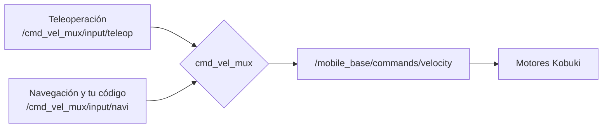

# TurtleBot 2

El TurtleBot 2 es un robot de investigación y docencia muy extendido. Está formado por una
base **Kobuki**, una estructura de bandejas y, en nuestro caso, un ordenador **KIRA** y un
láser **Hokuyo URG**.

Al terminar esta página sabrás encenderlo, qué hay instalado en el KIRA, qué topics publica y
cómo hacer un mapa y navegar con él.

## 1. Partes del robot

| Parte | Qué es | Cómo se conecta |
|---|---|---|
| **Base Kobuki** | Base de tracción diferencial con batería, odometría, giróscopo, bumpers y sensores de caída | Por USB al KIRA |
| **KIRA** | El ordenador del robot. Tiene instalados ROS y todos los paquetes que usamos | Va montado en el robot |
| **Láser Hokuyo URG** | Láser 2D. Es el sensor que usa la navegación para hacer mapas y localizarse | Por USB al KIRA |

Sensores que trae la base Kobuki por sí misma:

- **Encoders** en las dos ruedas, de los que sale la odometría.
- **Giróscopo** para medir los giros con más precisión.
- **Bumpers** (parachoques) delante y a los lados: detectan choques.
- **Sensores de caída** (*cliff*): detectan escalones y bordes.
- **Sensores de rueda en el aire** (*wheel drop*): detectan si se levanta el robot.

!!! info "El láser va en un sitio fijo del robot"
    ROS necesita saber dónde está el láser respecto a la base. En nuestro TurtleBot está
    **10 cm por delante** del centro de la base y a **45 cm de altura**, sin girar. Esa
    información se publica con una transformada estática (ver el [apartado 5](#5-hacer-un-mapa)).
    Si alguien mueve el láser de sitio, hay que actualizar esos números.

## 2. Encender el robot

1. Comprueba que el **láser** y la **base Kobuki** están conectados por USB al KIRA.
2. Enciende la **base Kobuki** con el interruptor de su lateral. Suena un pitido y se enciende
   un LED.
3. Enciende el **KIRA**.

Para apagar, sigue el orden inverso: cierra todos los programas con ++ctrl+c++, apaga el KIRA
desde Ubuntu y después apaga la base con su interruptor.

!!! tip "Batería"
    La base se carga con su cargador o en su estación de carga. Puedes ver el nivel de batería en
    el topic `/mobile_base/sensors/core` (campo `battery`, en décimas de voltio) cuando la base
    esté lanzada. Si el robot se mueve de forma rara o el láser deja de responder, sospecha
    primero de la batería.

## 3. Trabajar con el KIRA

Todos los paquetes del robot están **instalados en el KIRA**: no tienes que instalar nada en
tu portátil para mover el robot. Tienes dos formas de trabajar:

=== "Directamente en el KIRA"

    Conecta pantalla, teclado y ratón al KIRA y abre terminales en él. Es lo más sencillo
    para las primeras pruebas, con el robot quieto.

=== "Desde tu portátil por SSH"

    Conéctate a la misma red que el KIRA y entra por SSH:

    ```bash
    ssh USUARIO@IP_DEL_KIRA
    ```

    La IP y el usuario te los da tu tutor/a. Para lanzar varios comandos a la vez, usa `tmux`
    (explicado en [ROS en varios ordenadores](../tutoriales/ros-red.md#que-no-se-corte-al-cerrar-la-terminal-tmux)).
    Si quieres usar RViz en tu portátil, configura la red ROS como explica ese mismo tutorial,
    con el master en el KIRA.

## 4. Paquetes instalados y topics

### Paquetes

| Paquete | Para qué sirve | Lo que usamos |
|---|---|---|
| `turtlebot_bringup` | Arranca la base Kobuki: driver, odometría, modelo del robot y el multiplexor de velocidades | `minimal.launch` |
| `urg_node` | Driver del láser Hokuyo URG | `urg_lidar.launch` |
| `tf2_ros` | Publica la transformada fija entre la base y el láser | `static_transform_publisher` |
| `turtlebot_navigation` | Configuración de mapeado y navegación para el TurtleBot, **con los launch adaptados por el grupo** | `gmapping_tb3.launch`, `navegar.launch` |
| `turtlebot3_navigation` | Usamos su configuración de localización | `amcl.launch` |
| `map_server` | Guardar y cargar mapas | `map_saver`, `map_server` |
| `turtlebot_teleop` | Mover el robot con el teclado | `keyboard_teleop.launch` |

### Topics principales

Con la base y el láser lanzados, estos son los topics que más vas a usar:

| Topic | Tipo | Qué contiene |
|---|---|---|
| `/scan` | `sensor_msgs/LaserScan` | Lecturas del láser URG |
| `/odom` | `nav_msgs/Odometry` | Odometría de la base (posición y velocidad estimadas) |
| `/mobile_base/sensors/imu_data` | `sensor_msgs/Imu` | Giróscopo de la base |
| `/mobile_base/sensors/core` | `kobuki_msgs/SensorState` | Estado de la base: batería, encoders, bumpers... |
| `/mobile_base/events/bumper` | `kobuki_msgs/BumperEvent` | Se publica cuando un bumper se pulsa o se suelta |
| `/mobile_base/events/cliff` | `kobuki_msgs/CliffEvent` | Se publica cuando se detecta un borde o escalón |
| `/mobile_base/events/wheel_drop` | `kobuki_msgs/WheelDropEvent` | Se publica cuando una rueda queda en el aire |
| `/mobile_base/commands/velocity` | `geometry_msgs/Twist` | Velocidad que llega finalmente a los motores |
| `/cmd_vel_mux/input/teleop` | `geometry_msgs/Twist` | Entrada de velocidad para teleoperación |
| `/cmd_vel_mux/input/navi` | `geometry_msgs/Twist` | Entrada de velocidad para la navegación y tu código |
| `/tf`, `/tf_static` | | Transformadas (`odom → base_footprint → base_link → laser`) |
| `/joint_states` | `sensor_msgs/JointState` | Posición de las ruedas |

### Cómo se mueve: el multiplexor de velocidades

El TurtleBot 2 **no** escucha directamente en `/cmd_vel`. Tiene un **multiplexor**
(`cmd_vel_mux`) que recibe velocidades de varias fuentes y deja pasar solo la de **mayor
prioridad**:



- La **teleoperación tiene prioridad** sobre la navegación. Mientras teleoperas, se ignora lo que
  mande `move_base`.
- Para mover el robot **desde tu código**, publica en `/cmd_vel_mux/input/navi`.

Por ejemplo, para que avance despacio durante unos segundos (con el robot en una zona
despejada):

```bash
rostopic pub -r 10 /cmd_vel_mux/input/navi geometry_msgs/Twist \
  '{linear: {x: 0.1, y: 0.0, z: 0.0}, angular: {x: 0.0, y: 0.0, z: 0.0}}'
```

Páralo con ++ctrl+c++: al dejar de recibir mensajes, la base se detiene sola.

!!! tip "Cómo comprobar quién escucha un topic"
    `rostopic info /cmd_vel_mux/input/navi` muestra qué nodos publican y cuáles están suscritos.
    Si no aparece ningún suscriptor, la base no está lanzada.

## 5. Hacer un mapa

Cada comando va **en una terminal distinta**, y en este orden. Ejecútalos en el KIRA.

```bash
# Terminal 1: base Kobuki
roslaunch turtlebot_bringup minimal.launch

# Terminal 2: láser
roslaunch urg_node urg_lidar.launch

# Terminal 3: posición del láser respecto a la base (x y z qx qy qz qw padre hijo)
rosrun tf2_ros static_transform_publisher 0.1 0 0.45 0 0 0 1 base_link laser

# Terminal 4: SLAM con gmapping
roslaunch turtlebot_navigation gmapping_tb3.launch

# Terminal 5: teleoperación con el teclado
roslaunch turtlebot_teleop keyboard_teleop.launch
```

Mueve el robot **despacio** por todo el entorno, pasando cerca de las paredes y volviendo al
punto de partida al final. Puedes ver cómo se construye el mapa en RViz (fija **Fixed Frame**
en `map` y añade los displays **Map** y **LaserScan**).

Cuando el mapa esté completo, guárdalo **sin cerrar nada**:

```bash
# Terminal 6
cd ~/mapas          # el mapa se guarda en la carpeta donde estés
rosrun map_server map_saver -f nombreDelMapa
```

Se crean `nombreDelMapa.pgm` (la imagen) y `nombreDelMapa.yaml` (resolución y origen).

## 6. Navegar con el mapa

Cierra todo y lanza, de nuevo cada uno en su terminal:

```bash
# Terminales 1, 2 y 3: igual que para mapear
roslaunch turtlebot_bringup minimal.launch
roslaunch urg_node urg_lidar.launch
rosrun tf2_ros static_transform_publisher 0.1 0 0.45 0 0 0 1 base_link laser

# Terminal 4: cargar el mapa
cd ~/mapas
rosrun map_server map_server nombreDelMapa.yaml

# Terminal 5: localización
roslaunch turtlebot3_navigation amcl.launch

# Terminal 6: navegación (move_base con la configuración del grupo)
roslaunch turtlebot_navigation navegar.launch
```

En RViz:

1. Pulsa **2D Pose Estimate** y marca dónde está el robot y hacia dónde mira. El láser debe
   coincidir con las paredes del mapa.
2. Pulsa **2D Nav Goal** y marca el destino.

Para mandar objetivos desde Python, el código del
[tutorial de navegación](../tutoriales/navegacion.md#5-enviar-objetivos-desde-python) funciona
igual en el TurtleBot 2: el action server es `move_base` y el sistema de referencia, `map`.

## Problemas frecuentes

??? failure "El láser no arranca: `Error connecting to Hokuyo` o permiso denegado en `/dev/ttyACM0`"
    - Comprueba que el láser está conectado: `ls /dev/ttyACM*` debe mostrar al menos un dispositivo.
    - Si el error es de permisos, el usuario del KIRA tiene que estar en el grupo `dialout`:
      `sudo usermod -a -G dialout $USER` y reinicia la sesión.
    - Si hay varios dispositivos `ttyACM`, puede que el láser no sea el `0`. Desconéctalo,
      mira la lista, conéctalo y mira cuál aparece nuevo.

??? failure "`minimal.launch` dice que no encuentra la base Kobuki"
    - ¿Está encendida la base y conectado su cable USB?
    - Comprueba que existe `/dev/kobuki` con `ls -l /dev/kobuki`. Si no existe, avisa a tu tutor/a:
      falta la regla de udev en el KIRA.

??? failure "El robot no se mueve aunque `move_base` calcula una ruta"
    - ¿Está la teleoperación lanzada y mandando velocidad cero? Tiene más prioridad que la
      navegación: ciérrala.
    - Si un bumper está pulsado o una rueda está en el aire, la base se bloquea por seguridad.
    - Comprueba la batería.

??? failure "En RViz el láser aparece girado o desplazado respecto al mapa"
    La transformada estática `base_link → laser` no se ha lanzado o tiene valores incorrectos.
    Comprueba la terminal 3 y que el láser no se ha movido de sitio.

??? failure "`Could not transform` o `Timed out waiting for transform`"
    Falta alguno de los nodos que publican transformadas: la base (`odom → base_link`), la
    transformada estática (`base_link → laser`) o `amcl` (`map → odom`). Revisa que todas
    las terminales siguen en marcha.
