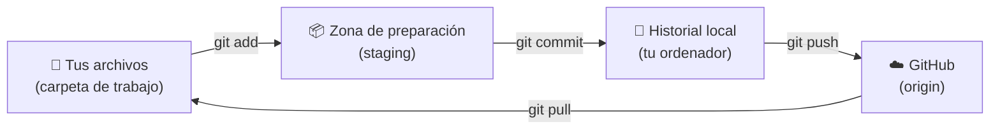

# Git y GitHub: primeros pasos

Al terminar este tutorial tendrás Git instalado y conectado a GitHub, habrás clonado
tu repositorio y sabrás guardar y subir tu trabajo cada día.

## Qué es Git y qué es GitHub

**Git** es un programa que guarda el historial de tu código. Cada vez que haces un
*commit* guardas una "foto" de tu proyecto con un mensaje que explica qué cambiaste.
Puedes volver a cualquier foto anterior, ver qué cambió entre dos fotos y trabajar en
varias versiones a la vez.

**GitHub** es una web donde se guarda una copia de tus repositorios. Sirve de copia de
seguridad, permite que tu tutor/a vea tu trabajo y hace posible colaborar.

Git funciona en tu ordenador aunque no tengas internet. Solo necesitas conexión para
**subir** (*push*) o **bajar** (*pull*) cambios de GitHub.

## Conceptos clave

| Término | Qué significa |
|---|---|
| **Repositorio** (repo) | Una carpeta de proyecto cuyo historial controla Git |
| **Commit** | Una "foto" guardada del proyecto, con un mensaje |
| **Remoto** (`origin`) | La copia del repositorio que está en GitHub |
| **Clonar** (`clone`) | Descargar un repositorio de GitHub a tu ordenador por primera vez |
| **Pull** | Bajar a tu ordenador los cambios nuevos de GitHub |
| **Push** | Subir a GitHub tus commits |
| **Rama** (*branch*) | Una línea de trabajo paralela (lo vemos en el [tutorial 2](02-ramas.md)) |

Un cambio pasa por tres sitios antes de llegar a GitHub:



- `git add` elige **qué cambios** van en el próximo commit.
- `git commit` guarda la foto **en tu ordenador**.
- `git push` sube tus commits **a GitHub**. Hasta que no haces push, nadie más los ve
  y no tienes copia de seguridad.

## 1. Instalar Git

=== "Ubuntu"

    ```bash
    sudo apt update
    sudo apt install git
    git --version
    ```

=== "Windows"

    Descarga e instala **Git for Windows** desde [git-scm.com](https://git-scm.com/download/win).
    Deja las opciones por defecto. Después usa el programa **Git Bash** para escribir
    los comandos de este tutorial.

=== "macOS"

    ```bash
    xcode-select --install
    git --version
    ```

## 2. Decirle a Git quién eres

Solo hay que hacerlo una vez por ordenador. Usa **el mismo correo** que en tu cuenta de
GitHub, para que tus commits aparezcan asociados a tu usuario.

```bash
git config --global user.name "Nombre Apellido"
git config --global user.email "tu_correo@ejemplo.com"
git config --global init.defaultBranch main
git config --global pull.rebase false
git config --global core.editor nano
```

!!! note "¿Qué hace cada línea?"
    Las dos primeras ponen tu nombre en los commits. `init.defaultBranch main` llama
    `main` a la rama principal de los repos nuevos. `pull.rebase false` fija el
    comportamiento de `git pull` para que no te pregunte cada vez. `core.editor nano`
    usa un editor sencillo cuando Git te pida escribir un mensaje (el editor por
    defecto, `vim`, desconcierta bastante al principio).

## 3. Conectar tu ordenador con GitHub (clave SSH)

GitHub no deja subir cambios con tu contraseña. La forma más cómoda es una **clave SSH**:
la configuras una vez y no vuelves a escribir nada.

1. Genera la clave (pulsa ++enter++ en todas las preguntas):

    ```bash
    ssh-keygen -t ed25519 -C "tu_correo@ejemplo.com"
    ```

2. Muestra la parte **pública** de la clave y cópiala entera:

    ```bash
    cat ~/.ssh/id_ed25519.pub
    ```

3. En GitHub, ve a tu foto (arriba a la derecha) → **Settings** → **SSH and GPG keys** →
   **New SSH key**. Ponle un nombre (por ejemplo "Portátil" o "PC laboratorio") y pega la clave.

4. Comprueba que funciona:

    ```bash
    ssh -T git@github.com
    ```

    La primera vez te preguntará si confías en el servidor: escribe `yes`. Si ves
    `Hi tu-usuario! You've successfully authenticated`, ya está.

!!! warning "Nunca compartas el archivo `id_ed25519` (sin `.pub`)"
    Es tu clave **privada**. Lo que se pega en GitHub es solo el archivo `.pub`.
    Si trabajas en varios ordenadores, genera una clave en cada uno.

## 4. Clonar tu repositorio

Tu tutor/a habrá creado tu repositorio en la organización. Entra en él en GitHub,
pulsa el botón verde **Code** → pestaña **SSH** y copia la dirección. Después:

```bash
mkdir -p ~/repos
cd ~/repos
git clone git@github.com:mobilerobotsUC3M-nav/tfg-2026-apellido-tema.git
cd tfg-2026-apellido-tema
```

Ahora tienes una carpeta con todo el contenido del repositorio y su historial.

!!! tip "Usa siempre la dirección SSH"
    Empieza por `git@github.com:`. Si clonaste con la dirección `https://`, Git te pedirá
    usuario y contraseña al hacer push y fallará. Se arregla con:
    `git remote set-url origin git@github.com:mobilerobotsUC3M-nav/NOMBRE-DEL-REPO.git`

## 5. El ciclo de trabajo de cada día

Esta es la rutina que vas a repetir siempre. Apréndetela.

```bash
# 1. ANTES de empezar: baja los cambios que haya en GitHub
git pull

# 2. Trabaja normalmente: edita, crea archivos, prueba...

# 3. Mira qué has cambiado
git status
git diff                     # muestra las líneas cambiadas

# 4. Prepara los cambios que quieres guardar
git add python/src/planner.py
git add docs/                # también puedes añadir carpetas enteras

# 5. Guarda la foto con un mensaje claro
git commit -m "Añade planificador A* básico"

# 6. Súbelo a GitHub
git push
```

Vamos paso a paso.

### `git pull`: siempre lo primero

Baja a tu ordenador lo que haya cambiado en GitHub desde la última vez: algo que subiste
desde otro ordenador, una corrección de tu tutor/a... Si te saltas este paso y alguien
más ha tocado el repo, tendrás conflictos al hacer push.

### `git status`: tu mejor amigo

Te dice en qué rama estás, qué archivos has modificado, cuáles están preparados para el
commit y cuáles son nuevos. Úsalo constantemente; no rompe nada.

```text
On branch main
Changes not staged for commit:
        modified:   python/src/planner.py

Untracked files:
        python/src/utils.py
```

- **modified**: archivos que Git ya conocía y has cambiado.
- **Untracked**: archivos nuevos que Git todavía no sigue. Hasta que no hagas `git add`,
  no se guardarán nunca.

### `git add`: elegir qué guardar

```bash
git add archivo.py           # un archivo
git add python/              # una carpeta entera
git add .                    # todo lo que haya cambiado (¡mira antes git status!)
```

!!! danger "Cuidado con `git add .`"
    Añade **todo**, incluidos archivos que no deberían subirse: datos pesados, rosbags,
    carpetas `build/`... Antes de usarlo, mira `git status` y asegúrate de que tu
    `.gitignore` está bien (ver más abajo).

### `git commit`: guardar la foto

```bash
git commit -m "Corrige el cálculo de la heurística en A*"
```

Un buen mensaje dice **qué** hace el cambio, en una frase corta. Imagina que completa la
frase *"Este commit…"*:

| ✅ Bien | ❌ Mal |
|---|---|
| `Añade nodo ROS que publica el path` | `cambios` |
| `Corrige el signo del ángulo en odometría` | `arreglos varios` |
| `Ajusta parámetros del costmap local` | `asdf` |
| `Añade notebook con pruebas de RRT` | `ya funciona!!!` |

Haz commits **pequeños y frecuentes**: uno por cada cosa que funciona, no uno gigante al
final de la semana.

### `git push`: subir a GitHub

```bash
git push
```

Después, entra en tu repositorio en GitHub y comprueba que tus cambios aparecen. Si no
haces push, **tu trabajo solo existe en tu ordenador**.

## 6. Ver el historial

```bash
git log --oneline            # lista corta de commits
git log --oneline --graph    # con dibujo de las ramas
git show a1b2c3d             # qué cambió en un commit concreto
```

## 7. El archivo `.gitignore`

Es un archivo en la raíz del repo que le dice a Git **qué no debe seguir nunca**. Tu
repositorio de TFG ya trae uno desde la plantilla. Un ejemplo de lo que contiene:

```gitignore
# Python
__pycache__/
*.pyc
.venv/
.ipynb_checkpoints/

# ROS (catkin)
catkin_ws/build/
catkin_ws/devel/
catkin_ws/install/
catkin_ws/logs/

# Datos pesados
*.bag
data/raw/

# Sistema y editores
.DS_Store
.vscode/
```

Si un archivo aparece en `git status` y no debería subirse, añade su nombre o su patrón
al `.gitignore`.

## 8. Me he equivocado, ¿y ahora qué?

| Situación | Comando |
|---|---|
| He cambiado un archivo y quiero dejarlo como estaba en el último commit | `git restore archivo.py` |
| He hecho `git add` de algo que no quería | `git restore --staged archivo.py` |
| Me he equivocado en el mensaje del último commit (**y aún no he hecho push**) | `git commit --amend -m "Mensaje bueno"` |
| Quiero deshacer un commit que **ya está en GitHub** | `git revert a1b2c3d` (crea un commit nuevo que deshace aquel) |
| He subido por error un archivo enorme o con contraseñas | Para y avisa a tu tutor/a; no intentes arreglarlo a ciegas |

!!! warning "`git restore archivo.py` borra tus cambios en ese archivo"
    No se puede deshacer. Úsalo solo cuando estés seguro/a de que quieres tirar lo que
    hiciste desde el último commit.

## 9. Trabajar desde VS Code

Si usas **Visual Studio Code**, tiene Git integrado: el icono de ramas de la barra lateral
muestra los archivos cambiados y permite hacer add (`+`), commit y push (*Sync*) con
botones. Es cómodo, pero aprende primero los comandos: cuando algo falle, entenderás qué
está pasando.

## Chuleta

```bash
git pull                       # 1. Antes de empezar
git status                     # ¿Qué he cambiado?
git diff                       # ¿Qué líneas exactamente?
git add <archivo|carpeta>      # Elegir qué guardar
git commit -m "Mensaje claro"  # Guardar la foto
git push                       # Subir a GitHub
git log --oneline              # Ver historial
```

**Siguiente:** [Ramas y pull requests :octicons-arrow-right-24:](02-ramas.md)
