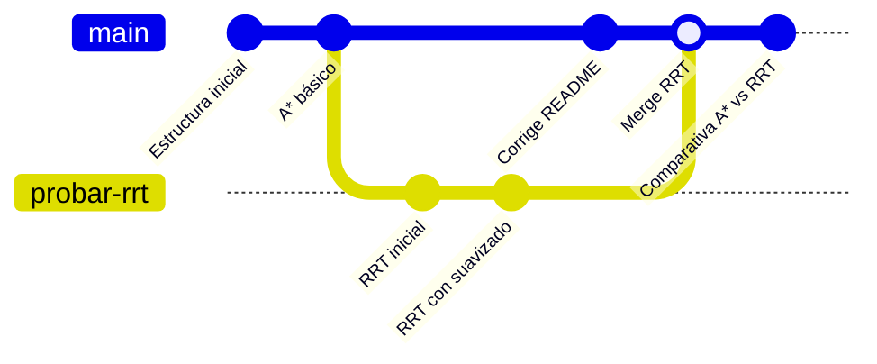

# Git y GitHub: ramas y pull requests

En este tutorial aprenderás a trabajar en ramas para probar cosas sin romper lo que ya
funciona, y a usar *pull requests* para que tu tutor/a revise tu código.

!!! note "Requisito"
    Haber hecho [Primeros pasos](01-primeros-pasos.md): tener Git configurado y tu repo clonado.

## Para qué sirven las ramas

La rama `main` es la versión **que funciona** de tu proyecto. Cuando quieras probar algo
nuevo (otro algoritmo, cambiar la estructura de un nodo, una idea que no sabes si saldrá
bien), crea una **rama**: una copia paralela donde puedes romper lo que quieras.

- Si la prueba sale bien, **fusionas** (*merge*) la rama en `main`.
- Si sale mal, la abandonas y `main` sigue intacta.



## Comandos básicos

```bash
git branch                       # lista las ramas (la actual lleva *)
git switch -c probar-rrt         # crea una rama nueva y te cambia a ella
git switch main                  # vuelve a main
git switch probar-rrt            # vuelve a la rama
```

!!! tip "Antes de cambiar de rama, haz commit"
    Si tienes cambios sin guardar, Git puede no dejarte cambiar de rama o llevarse los
    cambios contigo. Haz `git status`, y si hay cambios, haz commit antes de `git switch`.

### Nombres de rama

Cortos, en minúscula y con guiones. Que se entienda qué contienen:

| ✅ Bien | ❌ Mal |
|---|---|
| `probar-teb-planner` | `rama1` |
| `nodo-deteccion-puertas` | `prueba` |
| `fix-transformada-camara` | `MariaCambios` |

## Subir una rama a GitHub

La primera vez que subes una rama nueva hay que decirle a Git dónde va:

```bash
git push -u origin probar-rrt
```

A partir de ahí, con `git push` a secas basta mientras estés en esa rama.

## Pull requests: pedir que se revise y se fusione

Un **pull request** (PR) es una petición en GitHub para fusionar tu rama en `main`. Sirve
para que otra persona (tu tutor/a) **revise el código antes** de que entre en la versión
buena, y deja comentarios línea a línea.

### Paso a paso

1. Trabaja en tu rama y súbela:

    ```bash
    git switch -c nodo-deteccion-puertas
    # ... trabajas, haces commits ...
    git push -u origin nodo-deteccion-puertas
    ```

2. Entra en tu repo en GitHub. Verás un aviso amarillo con el botón
   **Compare & pull request**. Púlsalo.

3. Rellena el PR:
    - **Título**: qué aporta, en una frase (`Añade nodo de detección de puertas`).
    - **Descripción**: qué has hecho, cómo probarlo y si hay algo que te preocupe.
    - A la derecha, en **Reviewers**, añade a tu tutor/a.

4. Pulsa **Create pull request**.

5. Tu tutor/a dejará comentarios. Para corregir, **sigue trabajando en la misma rama** y
   haz push: los commits nuevos se añaden solos al PR.

6. Cuando esté aprobado, pulsa **Merge pull request** → **Confirm merge** y después
   **Delete branch**.

7. En tu ordenador, vuelve a `main` y actualízala:

    ```bash
    git switch main
    git pull
    git branch -d nodo-deteccion-puertas   # borra la rama local
    ```

!!! example "Plantilla para la descripción de un PR"
    ```markdown
    ## Qué hace
    Añade un nodo que detecta puertas en el láser y publica su posición en /doors.

    ## Cómo probarlo
    roslaunch deteccion_puertas demo.launch bag:=data/pasillo.bag

    ## Dudas
    El umbral de distancia está puesto a mano (0.8 m); no sé si debería ser parámetro.
    ```

## Conflictos

Un **conflicto** ocurre cuando dos cambios tocan **las mismas líneas** del mismo archivo
y Git no sabe con cuál quedarse. Pasa, por ejemplo, si cambias algo en tu portátil y en el
PC del laboratorio sin hacer pull entre medias. No es grave: Git te pide que decidas tú.

Cuando hay conflicto, Git marca el archivo así:

```text
<<<<<<< HEAD
resolution = 0.05
=======
resolution = 0.1
>>>>>>> probar-rrt
```

- Entre `<<<<<<< HEAD` y `=======`: lo que había en tu rama actual.
- Entre `=======` y `>>>>>>>`: lo que viene de la otra rama.

Para resolverlo:

1. Abre el archivo, deja **solo la versión correcta** (o una mezcla) y **borra las tres
   líneas de marcas** (`<<<<<<<`, `=======`, `>>>>>>>`).
2. Guarda el archivo y termina:

    ```bash
    git add archivo_con_conflicto.py
    git commit -m "Resuelve conflicto en la resolución del mapa"
    git push
    ```

!!! tip "VS Code ayuda mucho con los conflictos"
    Al abrir un archivo con conflicto, VS Code muestra botones encima de cada bloque:
    *Accept Current Change*, *Accept Incoming Change*, *Accept Both Changes*.

!!! warning "Si te agobias"
    `git merge --abort` cancela el merge y deja todo como estaba antes. Luego pide ayuda.

## ¿Ramas en un TFG individual?

Aunque seas la única persona que trabaja en tu repo, las ramas te vienen bien:

- **Para experimentos**: probar otro planificador sin estropear el que funciona.
- **Para revisiones**: abrir un PR cuando quieras que tu tutor/a revise algo concreto.
  Es más cómodo para ambos que mandar código por correo.

Para cambios pequeños del día a día (corregir un comentario, actualizar el README)
puedes trabajar directamente en `main`.

**Siguiente:** [Buenas prácticas :octicons-arrow-right-24:](03-buenas-practicas.md)
