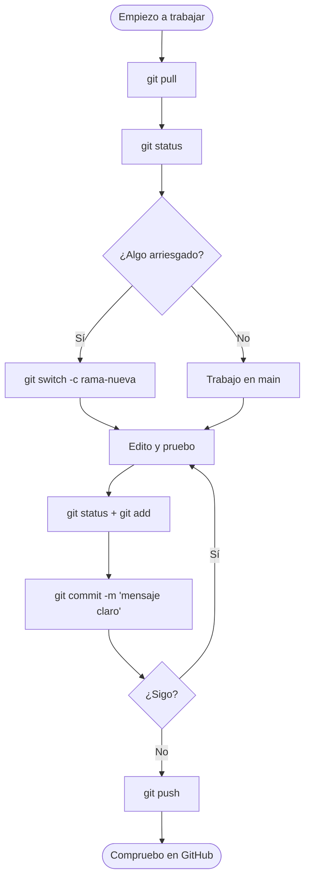

# Git y GitHub: buenas prácticas

Esta página es una **lista de comprobación** para tener a mano. Si la sigues, evitarás casi
todos los problemas habituales con Git.

## Al empezar a trabajar

- [ ] **`git pull`** antes de tocar nada. Siempre. Aunque creas que nadie ha cambiado nada.
- [ ] **`git status`** para comprobar en qué rama estás y que no tienes cambios a medias
      de la última vez.
- [ ] Si vas a probar algo arriesgado, **crea una rama** (`git switch -c nombre`).

!!! question "¿`git pull` me da error porque tengo cambios sin guardar?"
    Git no quiere pisar tu trabajo. Tienes dos opciones:

    - Haz commit de tus cambios y vuelve a hacer `git pull`.
    - O apártalos un momento: `git stash`, luego `git pull` y luego `git stash pop` para
      recuperarlos.

## Mientras trabajas

- [ ] Haz **commits pequeños**, uno por cada cosa que funcione o tenga sentido por sí misma.
- [ ] Escribe **mensajes que se entiendan** dentro de seis meses (`Añade filtro de mediana
      a la nube de puntos`, no `cambios`).
- [ ] Mira **`git status` antes de cada `git add`**, para no subir lo que no toca.
- [ ] No hagas commit de código que **no arranca** en `main`. Si está a medias, hazlo en una rama.

## Al terminar la sesión

- [ ] **`git push`** antes de irte. Si no, tu trabajo solo existe en ese ordenador.
- [ ] Comprueba en GitHub que tus commits aparecen.
- [ ] Si trabajas en **varios ordenadores** (portátil y laboratorio), la regla es:
      `push` al terminar en uno, `pull` al empezar en el otro.

<div class="rutina" markdown>

**La regla de oro:** `pull` al llegar, `push` al irte.

</div>

## Lo que nunca se sube a Git

| No subas | Por qué | Qué hacer en su lugar |
|---|---|---|
| **Rosbags** (`.bag`) y datasets grandes | Git no está hecho para archivos grandes; el repo se vuelve lentísimo y GitHub rechaza archivos de más de 100 MB | Guárdalos en la nube de la universidad y pon el enlace en el README |
| **`build/`, `devel/`, `install/`, `logs/`** de catkin | Se generan al compilar y dependen de cada ordenador | Ya están en el `.gitignore` |
| **`__pycache__/`, entornos virtuales** (`.venv/`) | Se generan solos | Ya están en el `.gitignore`; lista las dependencias en `requirements.txt` |
| **Contraseñas, tokens, claves API** | Quedan en el historial **para siempre**, aunque luego borres el archivo | Variables de entorno o un archivo local incluido en el `.gitignore` |
| **Pesos de redes neuronales grandes** | Mismo problema que los datasets | Enlace de descarga en el README, o Git LFS si el grupo lo decide |
| **Archivos personales** (PDFs de artículos, capturas sueltas) | Ensucian el repo | Una carpeta fuera del repo |

!!! danger "Si subes una contraseña por error"
    Cámbiala inmediatamente en el servicio correspondiente (eso es lo urgente) y avisa a tu
    tutor/a. Borrar el archivo con un commit nuevo **no la elimina del historial**.

## Organización del repositorio

Tu repo parte de la plantilla del grupo. Mantén esta estructura:

```text
tfg-2026-apellido-tema/
├── README.md          ← obligatorio y al día
├── requirements.txt   ← dependencias de Python
├── python/
│   ├── src/           ← código Python reutilizable (módulos, algoritmos)
│   └── notebooks/     ← pruebas y análisis en Jupyter
├── catkin_ws/
│   └── src/           ← tus paquetes de ROS (solo src/ va en Git)
├── data/              ← solo archivos pequeños de ejemplo
└── docs/              ← notas, figuras, material para la memoria
```

- **Lo que pruebes en Python primero**, en `python/`. Cuando funcione y lo lleves a ROS,
  crea el paquete en `catkin_ws/src/`.
- Si necesitas una carpeta más (`models/`, `config/`, `scripts/`), créala. La estructura
  es un mínimo, no un límite.
- **No dupliques código**: si un paquete de ROS usa el algoritmo de `python/src/`, impórtalo
  en vez de copiarlo.

### El README

Es lo primero que ve cualquiera que llegue a tu repo, incluido tu tribunal o la persona que
continúe tu trabajo. Debe responder a:

1. **¿Qué es?** Una o dos frases sobre el proyecto.
2. **¿Cómo se instala?** Dependencias y pasos.
3. **¿Cómo se ejecuta?** Los comandos exactos, copiables.
4. **¿Dónde están los datos?** Enlaces a rosbags o datasets.
5. **¿Qué hay en cada carpeta?** Una línea por carpeta basta.

Actualízalo cada vez que cambie la forma de instalar o ejecutar.

## Ramas y revisiones

- `main` debe funcionar **siempre**.
- Experimentos y cambios grandes → **rama + pull request**.
- Cuando quieras que tu tutor/a revise algo, abre un **PR** en lugar de mandar código por
  correo: los comentarios quedan junto al código.
- Borra las ramas cuando se fusionen.

## Antes de una reunión de seguimiento

- [ ] Todo subido (`git status` limpio y `git push` hecho).
- [ ] README actualizado con lo nuevo.
- [ ] Si hay algo que revisar, un PR abierto con una descripción breve.

## Resumen en una imagen


