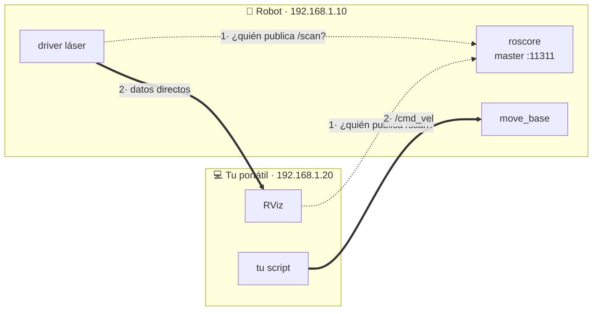

# ROS en varios ordenadores: conectarte al robot

Lo normal es que ROS corra **en el robot** (sensores, motores, navegación) y que tú lo
controles y visualices **desde tu portátil** (RViz, tus scripts, teleoperación). Para eso
los dos ordenadores tienen que formar una sola red ROS.

Al terminar este tutorial sabrás configurar `ROS_MASTER_URI`, `ROS_IP` y `ROS_HOSTNAME`,
entrar en el robot por SSH y diagnosticar los problemas de conexión más habituales.

!!! note "Requisitos"
    [ROS Noetic instalado](ros-noetic.md) en tu ordenador y saber lanzar nodos y ver topics.

## 1. Cómo funciona una red ROS



1. Hay **un solo master** (`roscore`) en toda la red, normalmente en el robot. Todos los
   nodos le preguntan quién publica qué.
2. Después, los nodos **se conectan directamente entre sí** para pasarse los datos. El
   master solo hace de "agenda".

De aquí salen las dos reglas que hay que cumplir:

| Regla | Variable que la controla |
|---|---|
| Todos los nodos tienen que saber **dónde está el master** | `ROS_MASTER_URI` |
| Cada ordenador tiene que anunciarse con una **dirección a la que los demás puedan llegar** | `ROS_IP` (o `ROS_HOSTNAME`) |

!!! warning "La conexión tiene que funcionar en los dos sentidos"
    No basta con que tu portátil llegue al robot: **el robot también tiene que llegar a tu
    portátil**, porque es el robot quien te envía directamente los datos del láser o la cámara.
    Casi todos los problemas de red en ROS vienen de aquí.

## 2. Las variables de entorno

| Variable | Qué indica | Ejemplo |
|---|---|---|
| `ROS_MASTER_URI` | Dirección del master. **Igual en todos los ordenadores** | `http://192.168.1.10:11311` |
| `ROS_IP` | La IP de **este** ordenador. **Distinta en cada uno** | `192.168.1.20` |
| `ROS_HOSTNAME` | Alternativa a `ROS_IP`: el nombre de **este** ordenador en la red | `portatil-maria` |

- Usa **`ROS_IP` o `ROS_HOSTNAME`, no las dos**. Si están las dos, ROS usa `ROS_HOSTNAME`
  e ignora la otra, lo que confunde mucho.
- En el grupo usamos **`ROS_IP`** por defecto: no depende de que los nombres se resuelvan bien.
- Estas variables valen **solo para la terminal donde las defines**. Cada terminal nueva
  hay que configurarla (o hacerlo en el `.bashrc`, ver el [apartado 5](#5-dejarlo-configurado-en-el-bashrc)).

Para ver qué tiene configurado una terminal:

```bash
env | grep ROS
```

## 3. Paso a paso: conectar tu portátil al robot

### 3.1. Misma red y averiguar las IPs

Conecta el portátil a **la misma red que el robot** (el router del laboratorio). En cada
ordenador, mira su IP:

```bash
hostname -I
```

Si salen varias, la buena es la de la red del robot (por ejemplo `192.168.1.x`). Las que
empiezan por `172.17.` suelen ser de Docker; ignóralas.

!!! warning "Ojo con eduroam y las wifis de la universidad"
    Muchas redes institucionales **bloquean las conexiones entre dispositivos**. Aunque los
    dos tengan internet, no se ven entre sí. Usa siempre la red del laboratorio.

En los ejemplos usaremos:

- Robot: `192.168.1.10`
- Tu portátil: `192.168.1.20`

### 3.2. Comprobar que se ven (en los dos sentidos)

```bash
# Desde el portátil
ping 192.168.1.10

# Desde el robot (por SSH, ver apartado 6)
ping 192.168.1.20
```

Si alguno de los dos falla, **no sigas**: el problema es de red, no de ROS. Revisa la
[sección de problemas](#problemas-frecuentes).

### 3.3. Configurar el robot

En **cada terminal del robot** donde vayas a lanzar algo:

```bash
export ROS_MASTER_URI=http://192.168.1.10:11311
export ROS_IP=192.168.1.10
```

Y arranca el master y los nodos del robot:

```bash
roscore            # o directamente el roslaunch del robot, que lo arranca solo
```

### 3.4. Configurar tu portátil

En **cada terminal del portátil**:

```bash
export ROS_MASTER_URI=http://192.168.1.10:11311   # el master está en el robot
export ROS_IP=192.168.1.20                        # pero yo soy el portátil
```

!!! danger "No lances `roscore` en el portátil"
    Solo puede haber un master. Si lanzas otro en tu portátil, tus nodos hablarán con ese y no
    verán nada del robot.

### 3.5. La prueba definitiva

Comprueba la comunicación **en los dos sentidos**:

=== "Robot → portátil"

    En el robot:
    ```bash
    rostopic pub -r 1 /prueba_robot std_msgs/String "data: 'hola desde el robot'"
    ```
    En el portátil:
    ```bash
    rostopic echo /prueba_robot
    ```

=== "Portátil → robot"

    En el portátil:
    ```bash
    rostopic pub -r 1 /prueba_portatil std_msgs/String "data: 'hola desde el portátil'"
    ```
    En el robot:
    ```bash
    rostopic echo /prueba_portatil
    ```

Si en ambos casos aparecen los mensajes, la red ROS está bien configurada.

!!! info "`rostopic list` no demuestra nada"
    `rostopic list` solo pregunta al master. Puede mostrar todos los topics del robot y aun así
    no llegar ningún dato, si `ROS_IP` está mal en uno de los dos lados. La prueba buena es
    `rostopic echo`.

## 4. Usar nombres en vez de IPs: `/etc/hosts`

Si prefieres escribir `turtlebot` en vez de `192.168.1.10`, o si el robot tiene configurado
`ROS_HOSTNAME` en lugar de `ROS_IP`, cada ordenador tiene que saber traducir los nombres de
los demás. Se hace en el archivo `/etc/hosts`:

```bash
sudo nano /etc/hosts
```

Añade una línea por máquina (en **todos** los ordenadores):

```text
192.168.1.10    turtlebot
192.168.1.20    portatil-maria
```

Comprueba que funciona con `ping turtlebot`. Ya puedes usar el nombre:

```bash
export ROS_MASTER_URI=http://turtlebot:11311
```

!!! warning "Si el robot usa `ROS_HOSTNAME`, tu portátil necesita conocer ese nombre"
    Es un error típico: el robot se anuncia como `turtlebot`, tu portátil no sabe qué IP es,
    y aparece `Couldn't find an AF_INET address for [turtlebot]`. Se arregla añadiendo el
    nombre al `/etc/hosts` del portátil. Puedes ver el nombre del robot con el comando `hostname`
    ejecutado en él.

## 5. Dejarlo configurado en el `.bashrc`

Escribir los `export` en cada terminal cansa. Lo cómodo es definir dos funciones en tu
`~/.bashrc` para cambiar entre trabajar **en local** (simulación) y **con el robot**:

```bash
nano ~/.bashrc
```

Añade al final (cambia las IPs por las vuestras):

```bash
# --- Red ROS ---------------------------------------------------------
ROBOT_IP=192.168.1.10

# Trabajar solo en mi ordenador (simulación, rosbags...)
ros_local() {
    export ROS_MASTER_URI=http://localhost:11311
    unset ROS_IP ROS_HOSTNAME
    echo "ROS en modo LOCAL"
}

# Trabajar con el robot real
ros_robot() {
    export ROS_MASTER_URI=http://${ROBOT_IP}:11311
    export ROS_IP=$(ip route get ${ROBOT_IP} | grep -oP 'src \K[\d.]+')
    unset ROS_HOSTNAME
    echo "ROS conectado al robot: master=${ROS_MASTER_URI}  mi IP=${ROS_IP}"
}

ros_local   # modo por defecto al abrir una terminal
```

Guarda, abre una terminal nueva y escribe `ros_robot` o `ros_local` según lo que vayas a hacer.
La función `ros_robot` calcula sola qué IP tuya está en la red del robot, así que funciona
aunque el router te dé una IP distinta cada día.

## 6. Entrar en el robot por SSH

Para lanzar cosas en el robot no hace falta conectarle teclado y pantalla: se usa **SSH**.

```bash
ssh usuario@192.168.1.10
```

Pide la contraseña del usuario del robot (pregúntala en el grupo). Para no escribirla cada vez,
copia tu clave SSH al robot (la que creaste en el [tutorial de Git](github/01-primeros-pasos.md#3-conectar-tu-ordenador-con-github-clave-ssh)):

```bash
ssh-copy-id usuario@192.168.1.10
```

### Que no se corte al cerrar la terminal: `tmux`

Si lanzas la navegación por SSH y se cae la wifi, el proceso muere y el robot se queda parado
(o peor, sigue con la última velocidad). Usa `tmux` en el robot:

```bash
tmux new -s robot          # abre una sesión
roslaunch ...              # lanza lo que necesites
```

| Acción | Teclas |
|---|---|
| Salir dejando todo en marcha | ++ctrl+b++ y luego ++d++ |
| Volver a la sesión | `tmux attach -t robot` |
| Abrir otra ventana dentro de tmux | ++ctrl+b++ y luego ++c++ |
| Cambiar de ventana | ++ctrl+b++ y luego el número |

!!! tip "Qué ejecutar en cada sitio"
    - **En el robot:** drivers, `roscore`, navegación (todo lo que necesita reaccionar rápido).
    - **En tu portátil:** RViz, `rqt`, teleoperación y tus scripts mientras los desarrollas.

    No abras RViz en el robot reenviando la pantalla por SSH (`ssh -X`): va lentísimo.

## 7. Relojes sincronizados

ROS usa la hora de cada ordenador para sellar los mensajes. Si los relojes del robot y del
portátil no coinciden, aparecen errores de transformadas como
`Lookup would require extrapolation into the future` y la navegación falla.

Compara la hora en los dos (ejecutando `date` en ambos a la vez). Si hay más de unas décimas
de segundo de diferencia, instala `chrony` en **los dos** ordenadores:

```bash
sudo apt install -y chrony
```

Con internet, ambos se sincronizarán solos. Si la red del robot **no tiene internet**,
habla con tu tutor/a: hay que configurar uno de los dos como servidor de hora del otro.

## Problemas frecuentes

??? failure "`ERROR: Unable to communicate with master!`"
    - ¿Está lanzado `roscore` (o el launch del robot) en el robot?
    - Comprueba `echo $ROS_MASTER_URI` en esa terminal.
    - ¿Responde `ping` a la IP del robot?

??? failure "`rostopic list` muestra los topics, pero `rostopic echo` no muestra nada"
    El clásico: `ROS_IP` está mal o falta en uno de los dos ordenadores, o la conexión solo
    funciona en un sentido. Revisa `env | grep ROS` en **los dos** y haz las pruebas del
    [apartado 3.5](#35-la-prueba-definitiva).

??? failure "`Couldn't find an AF_INET address for [nombre]`"
    Algún ordenador se anuncia con un nombre que el otro no sabe resolver. Pon `ROS_IP` en vez
    de `ROS_HOSTNAME`, o añade el nombre a `/etc/hosts` ([apartado 4](#4-usar-nombres-en-vez-de-ips-etchosts)).

??? failure "El ping funciona en un sentido pero no en el otro"
    Suele ser el cortafuegos del portátil. Mira su estado con `sudo ufw status`. Si está activo,
    permite el tráfico de la red del robot:
    ```bash
    sudo ufw allow from 192.168.1.0/24
    ```

??? failure "Todo funciona por cable pero la imagen de la cámara va a tirones por wifi"
    Las imágenes sin comprimir saturan la wifi. En el portátil, suscríbete a la versión
    comprimida (`/camera/color/image_raw/compressed`) o baja la resolución y los FPS de la
    cámara en el robot.

??? failure "Errores de tf de 'extrapolation into the future / past'"
    Relojes desincronizados. Mira el [apartado 7](#7-relojes-sincronizados).

## Chuleta

```bash
hostname -I                                   # mi IP
ping IP_DEL_OTRO                              # ¿nos vemos?
env | grep ROS                                # ¿qué tengo configurado?
export ROS_MASTER_URI=http://IP_ROBOT:11311   # dónde está el master (igual en todos)
export ROS_IP=MI_IP                           # quién soy yo (distinto en cada uno)
ssh usuario@IP_ROBOT                          # entrar en el robot
tmux attach -t robot                          # volver a la sesión del robot
```
