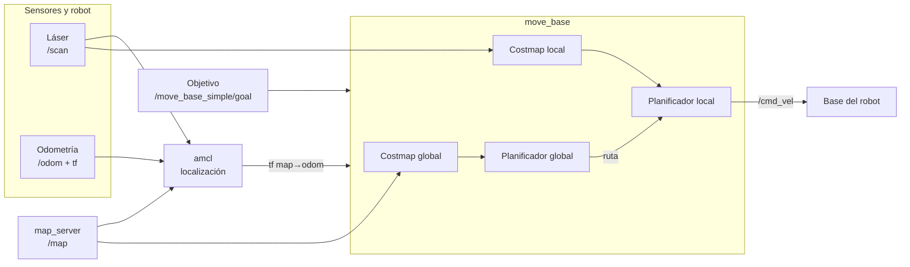

# Stack de navegación de ROS

<span class="bloque bloque-ros1">ROS 1 · Ubuntu 20.04 + Noetic</span>

Al terminar este tutorial entenderás las piezas del stack de navegación de ROS 1
(`navigation`), habrás hecho un mapa con SLAM y habrás mandado a un robot simulado a
navegar por él, tanto desde RViz como desde un script de Python.

!!! note "Requisitos"
    [ROS Noetic instalado](instalar-noetic.md) y saber lanzar nodos y ver topics. Todo el tutorial
    se hace en simulación con el robot **TurtleBot3** en Gazebo, así que no necesitas robot real.

## 1. Las piezas del stack

El stack de navegación responde a dos preguntas: **¿dónde estoy?** (localización) y
**¿cómo llego a donde quiero ir sin chocar?** (planificación).



| Pieza | Qué hace |
|---|---|
| **`map_server`** | Carga un mapa guardado (imagen `.pgm` + `.yaml`) y lo publica en `/map` |
| **`amcl`** | Localiza al robot dentro del mapa usando el láser y la odometría (filtro de partículas) |
| **`move_base`** | El núcleo: recibe un objetivo y genera las velocidades para llegar |
| **Costmap global** | Mapa de "coste" de todo el entorno: obstáculos del mapa, inflados con un margen de seguridad |
| **Planificador global** | Calcula la ruta completa desde la posición actual al objetivo (por ejemplo con Dijkstra o A\*) |
| **Costmap local** | Ventana pequeña alrededor del robot, actualizada con lo que ve el láser en ese momento |
| **Planificador local** | Sigue la ruta global esquivando obstáculos nuevos y genera `/cmd_vel` (por ejemplo DWA) |
| **Comportamientos de recuperación** | Si el robot se atasca: limpiar costmaps, girar sobre sí mismo... |

### Las transformadas (tf)

ROS necesita saber en todo momento cómo se relacionan los sistemas de coordenadas.
La cadena mínima para navegar es:

```text
map  →  odom  →  base_footprint  →  base_link  →  base_scan
 ↑        ↑              ↑                              ↑
amcl   odometría    (fija, URDF)                  (fija, URDF)
```

- `odom → base_footprint` la publica la odometría: es suave pero acumula error.
- `map → odom` la publica `amcl` y corrige ese error.

!!! tip "Lo que un robot real necesita para usar este stack"
    1. Odometría publicada en `/odom` y como tf `odom → base_link` (o `base_footprint`).
    2. Un sensor de distancia: láser en `/scan` (o una nube de puntos).
    3. Transformadas fijas de los sensores respecto a la base (normalmente desde el URDF).
    4. Una base que obedezca velocidades en `/cmd_vel` (`geometry_msgs/Twist`).

## 2. Instalar el TurtleBot3 y la navegación

```bash
sudo apt install -y ros-noetic-turtlebot3 ros-noetic-turtlebot3-simulations \
                    ros-noetic-navigation ros-noetic-gmapping ros-noetic-dwa-local-planner
```

El TurtleBot3 tiene varios modelos; usaremos `burger`. Indícalo en el `.bashrc`:

```bash
echo "export TURTLEBOT3_MODEL=burger" >> ~/.bashrc
source ~/.bashrc
```

Comprueba que la simulación arranca:

```bash
roslaunch turtlebot3_gazebo turtlebot3_world.launch
```

Debería abrirse Gazebo con un robot pequeño en un entorno hexagonal con columnas.

!!! info "La primera vez Gazebo puede tardar"
    Descarga modelos de internet en el primer arranque. Si la ventana se queda negra un
    minuto, espera.

## 3. Hacer un mapa con SLAM

Con la simulación del paso anterior abierta, abre **dos terminales más**:

=== "Terminal 2: SLAM"

    ```bash
    roslaunch turtlebot3_slam turtlebot3_slam.launch slam_methods:=gmapping
    ```

    Se abre RViz y verás cómo se construye el mapa a medida que el robot se mueve.

=== "Terminal 3: teleoperación"

    ```bash
    roslaunch turtlebot3_teleop turtlebot3_teleop_key.launch
    ```

    Con esta terminal seleccionada, mueve el robot con ++w++ ++a++ ++s++ ++d++ ++x++
    (++s++ para frenar).

Recorre todo el entorno **despacio**, pasando cerca de las paredes y cerrando el recorrido
por donde empezaste (eso ayuda a SLAM a corregir errores). Cuando el mapa esté completo,
guárdalo **sin cerrar nada**:

```bash
mkdir -p ~/mapas
rosrun map_server map_saver -f ~/mapas/turtlebot3_world
```

Se crean dos archivos:

- **`turtlebot3_world.pgm`**: la imagen del mapa. Blanco = libre, negro = ocupado, gris = desconocido.
- **`turtlebot3_world.yaml`**: la resolución (metros por píxel), el origen y los umbrales.

Ya puedes cerrar todas las terminales con ++ctrl+c++.

## 4. Navegar con el mapa

=== "Terminal 1: simulación"

    ```bash
    roslaunch turtlebot3_gazebo turtlebot3_world.launch
    ```

=== "Terminal 2: navegación"

    ```bash
    roslaunch turtlebot3_navigation turtlebot3_navigation.launch \
              map_file:=$HOME/mapas/turtlebot3_world.yaml
    ```

En RViz:

1. **Dile al robot dónde está.** Pulsa **2D Pose Estimate**, haz clic en el mapa donde está
   el robot en Gazebo y arrastra en la dirección en la que mira. Las flechas verdes
   (partículas de AMCL) deben agruparse alrededor del robot y el láser debe coincidir con
   las paredes del mapa.
2. **Mándalo a algún sitio.** Pulsa **2D Nav Goal**, haz clic en el destino y arrastra para
   indicar la orientación final.

Verás la **ruta global** (línea larga) y la **ruta local** (línea corta delante del robot),
y el robot irá hacia el objetivo.

!!! example "Experimenta"
    - Mientras el robot navega, añade un obstáculo en Gazebo (menú *Insert* o los cubos de la
      barra superior) en su camino. Observa cómo lo detecta el costmap local y lo esquiva.
    - Pon un objetivo dentro de una columna. ¿Qué hace el robot?
    - En RViz, activa y desactiva los costmaps para ver las zonas infladas alrededor de los obstáculos.

## 5. Enviar objetivos desde Python

En tu trabajo no vas a hacer clic en RViz: mandarás objetivos desde código. `move_base` es
un **action server**, así que se le habla con un cliente de `actionlib`, que permite enviar
un objetivo, esperar a que termine y saber si lo consiguió.

Crea un paquete y un script (repasa [cómo crear un paquete](instalar-noetic.md#8-tu-primer-paquete-y-nodo)):

```bash
cd ~/repos/tfg-2026-apellido-tema/catkin_ws/src
catkin_create_pkg mis_objetivos rospy actionlib move_base_msgs geometry_msgs tf
mkdir -p mis_objetivos/scripts
```

`mis_objetivos/scripts/ir_a_puntos.py`:

```python
#!/usr/bin/env python3
"""Manda al robot a una lista de puntos del mapa, uno detrás de otro."""
import math

import actionlib
import rospy
from move_base_msgs.msg import MoveBaseAction, MoveBaseGoal
from tf.transformations import quaternion_from_euler

# (x, y, orientación en grados) en el sistema de coordenadas del mapa.
# Comprueba en RViz que estos puntos caen en zona libre de TU mapa.
PUNTOS = [
    (0.5, 0.5, 0),
    (0.5, -0.5, -90),
    (-0.5, -0.5, 180),
]


def crear_objetivo(x, y, yaw_grados):
    goal = MoveBaseGoal()
    goal.target_pose.header.frame_id = "map"
    goal.target_pose.header.stamp = rospy.Time.now()
    goal.target_pose.pose.position.x = x
    goal.target_pose.pose.position.y = y
    q = quaternion_from_euler(0, 0, math.radians(yaw_grados))
    goal.target_pose.pose.orientation.x = q[0]
    goal.target_pose.pose.orientation.y = q[1]
    goal.target_pose.pose.orientation.z = q[2]
    goal.target_pose.pose.orientation.w = q[3]
    return goal


def main():
    rospy.init_node("ir_a_puntos")
    cliente = actionlib.SimpleActionClient("move_base", MoveBaseAction)
    rospy.loginfo("Esperando a move_base...")
    cliente.wait_for_server()

    for x, y, yaw in PUNTOS:
        rospy.loginfo(f"Yendo a ({x}, {y}, {yaw}°)")
        cliente.send_goal(crear_objetivo(x, y, yaw))
        terminado = cliente.wait_for_result(rospy.Duration(60))

        if not terminado:
            cliente.cancel_goal()
            rospy.logwarn("Tiempo agotado, paso al siguiente punto")
        elif cliente.get_state() == actionlib.GoalStatus.SUCCEEDED:
            rospy.loginfo("¡Llegado!")
        else:
            rospy.logwarn(f"No se pudo llegar (estado {cliente.get_state()})")


if __name__ == "__main__":
    main()
```

Hazlo ejecutable, añádelo a `catkin_install_python` en el `CMakeLists.txt`, compila y
lánzalo con la navegación del paso 4 en marcha (y la pose inicial ya puesta en RViz):

```bash
chmod +x mis_objetivos/scripts/ir_a_puntos.py
cd .. && catkin_make && source devel/setup.bash
rosrun mis_objetivos ir_a_puntos.py
```

!!! tip "¿Cómo sé las coordenadas de un punto del mapa?"
    En RViz, usa la herramienta **Publish Point** y haz clic en el mapa; luego mira las
    coordenadas con `rostopic echo /clicked_point`.

## 6. Los parámetros: donde está el trabajo de verdad

El comportamiento de `move_base` se controla con archivos YAML de parámetros. Para el
TurtleBot3 están en:

```bash
roscd turtlebot3_navigation/param
ls
```

| Archivo | Qué configura |
|---|---|
| `costmap_common_params_burger.yaml` | Tamaño del robot, sensores que alimentan los costmaps, inflado |
| `global_costmap_params.yaml` | Costmap global: frecuencia de actualización, marco de referencia |
| `local_costmap_params.yaml` | Costmap local: tamaño de la ventana, resolución |
| `dwa_local_planner_params_burger.yaml` | Velocidades y aceleraciones máximas, tolerancias al objetivo |
| `move_base_params.yaml` | Frecuencias, planificadores elegidos, recuperación |

Los parámetros que más se tocan:

| Parámetro | Dónde | Efecto |
|---|---|---|
| `inflation_radius` | costmap | Margen alrededor de los obstáculos. Más grande = más seguro, pero no pasa por sitios estrechos |
| `cost_scaling_factor` | costmap | Qué tan rápido baja el coste al alejarse de un obstáculo |
| `robot_radius` / `footprint` | costmap | Tamaño del robot. Si está mal, choca o no cabe por ningún sitio |
| `max_vel_x`, `max_vel_theta` | DWA | Velocidad máxima lineal y angular |
| `xy_goal_tolerance`, `yaw_goal_tolerance` | DWA | Cuánto se puede desviar del objetivo para darlo por alcanzado |
| `path_distance_bias`, `goal_distance_bias`, `occdist_scale` | DWA | Pesos: seguir la ruta global vs. ir al objetivo vs. alejarse de obstáculos |

**Ajustar en vivo:** con la navegación en marcha, ejecuta `rosrun rqt_reconfigure rqt_reconfigure`.
Puedes cambiar muchos parámetros y ver el efecto al momento, sin relanzar nada.

!!! warning "No edites los archivos de `/opt/ros`"
    Se pierden al actualizar y no están en tu repositorio. Copia la carpeta `param/` y el
    launch a **tu propio paquete** y modifica esas copias.

## 7. Cambiar de planificador

`move_base` funciona con *plugins*: puedes cambiar el planificador global o el local sin
tocar el resto.

| Tipo | Plugin | Notas |
|---|---|---|
| Global | `navfn/NavfnROS` | Dijkstra. El de por defecto |
| Global | `global_planner/GlobalPlanner` | Dijkstra o A\* (`use_dijkstra: false`), con más opciones |
| Local | `dwa_local_planner/DWAPlannerROS` | Dynamic Window Approach. El del TurtleBot3 |
| Local | `teb_local_planner/TebLocalPlannerROS` | Timed Elastic Band; trayectorias más suaves, útil para robots no holonómicos tipo coche. Paquete `ros-noetic-teb-local-planner` |

Se eligen en `move_base_params.yaml` o en el launch:

```yaml
base_global_planner: global_planner/GlobalPlanner
base_local_planner: dwa_local_planner/DWAPlannerROS
```

Si tu TFG es de **path planning**, lo normal es acabar escribiendo tu propio planificador
como plugin global (una clase que hereda de `nav_core::BaseGlobalPlanner`). Consulta el
tutorial oficial [Writing A Global Path Planner As Plugin in ROS](http://wiki.ros.org/navigation/Tutorials/Writing%20A%20Global%20Path%20Planner%20As%20Plugin%20in%20ROS).
Es recomendable prototipar antes el algoritmo en Python puro, en la carpeta `python/` de tu repo.

## 8. Herramientas de depuración

| Herramienta | Para qué |
|---|---|
| `rqt_graph` | Ver qué nodos están conectados a qué topics |
| `rosrun tf2_tools view_frames.py` | Genera `frames.pdf` con el árbol de transformadas |
| `rosrun tf tf_echo map base_footprint` | Ver la posición del robot en el mapa |
| `rostopic echo /move_base/status` | Estado del objetivo actual |
| `rostopic hz /scan` | Comprobar que el láser publica a su frecuencia |
| `rosservice call /move_base/clear_costmaps` | Limpiar costmaps llenos de "fantasmas" |

## Problemas frecuentes

??? failure "El robot no se mueve al dar un objetivo"
    Casi siempre es que no has puesto la pose inicial con **2D Pose Estimate**, o que el
    objetivo cae dentro de un obstáculo inflado. Mira los mensajes de la terminal de navegación.

??? failure "El robot gira sobre sí mismo una y otra vez"
    Son los comportamientos de recuperación: no encuentra camino. Revisa que la localización
    es buena (el láser debe coincidir con el mapa) y que `inflation_radius` no es tan grande
    que bloquee los pasos.

??? failure "Avisos `Timed out waiting for transform` o `Could not transform`"
    Falta algún eslabón del árbol de tf. Comprueba con `view_frames.py` que existe la cadena
    `map → odom → base_footprint → base_scan`.

??? failure "Gazebo va muy lento o la ventana sale negra"
    Gazebo necesita aceleración gráfica y en máquina virtual suele ir mal. Usa una instalación
    nativa de Ubuntu y comprueba que tienes instalados los drivers de la tarjeta gráfica.

## Para seguir aprendiendo

- [Documentación del stack de navegación](http://wiki.ros.org/navigation)
- [Guía de ajuste de parámetros de navegación (Kaiyu Zheng)](https://kaiyuzheng.me/documents/navguide.pdf):
  la referencia clásica para entender cada parámetro.
- [Manual del TurtleBot3 (ROBOTIS)](https://emanual.robotis.com/docs/en/platform/turtlebot3/navigation/):
  elige la pestaña de **Noetic**.
