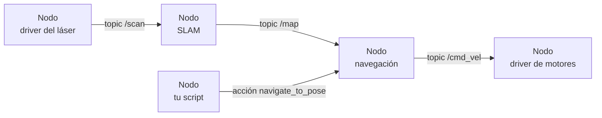

# Introducción a ROS 2

<span class="bloque bloque-ros2">ROS 2 · Ubuntu 24.04 + Jazzy</span>

Al terminar este tutorial sabrás cómo se organiza un sistema ROS 2, habrás creado tu espacio
de trabajo, un paquete en Python con un nodo que publica y otro que escucha, un *launch file*
y un parámetro.

!!! note "Requisitos"
    [ROS 2 Jazzy instalado](instalar-jazzy.md) y la prueba del `talker` y el `listener` funcionando.

## 1. Conceptos básicos

Un sistema ROS 2 es un conjunto de programas pequeños (**nodos**) que se comunican entre sí.
Cada nodo hace una cosa: leer el láser, estimar la posición, planificar una ruta, mover los
motores...



| Concepto | Qué es | Ejemplo |
|---|---|---|
| **Nodo** | Un programa que forma parte del sistema | El driver del láser |
| **Topic** | Un canal con nombre por el que se publican mensajes de forma continua. Cualquiera puede publicar y cualquiera puede escuchar | `/scan`, `/cmd_vel`, `/odom` |
| **Mensaje** | El tipo de dato que viaja por un topic | `sensor_msgs/msg/LaserScan`, `geometry_msgs/msg/Twist` |
| **Servicio** | Pregunta y respuesta puntual entre dos nodos | Pedir que se guarde el mapa |
| **Acción** | Una tarea larga que da información mientras se ejecuta y se puede cancelar | "Ve a este punto" |
| **Parámetro** | Un valor de configuración de un nodo, que se puede cambiar sin recompilar | Velocidad máxima |
| **Paquete** | La unidad en que se organiza y se comparte el código | `nav2_bringup` |

!!! info "La gran diferencia con ROS 1: no hay `roscore`"
    En ROS 2 los nodos **se descubren solos** a través de la red usando un sistema llamado
    DDS. No hay que arrancar ningún master. A cambio, hay que entender un poco cómo funciona
    ese descubrimiento cuando se trabaja con varios ordenadores
    (ver [ROS 2 en varios ordenadores](red.md)).

## 2. Explorar un sistema desde la terminal

Lanza el `talker` en una terminal y prueba estos comandos en otra:

```bash
ros2 run demo_nodes_cpp talker        # terminal 1
```

```bash
ros2 node list                         # nodos en marcha
ros2 node info /talker                 # qué publica, escucha y ofrece un nodo
ros2 topic list                        # topics que existen
ros2 topic info /chatter               # tipo y quién publica/escucha
ros2 topic echo /chatter               # ver los mensajes
ros2 topic hz /chatter                 # frecuencia de publicación
ros2 interface show std_msgs/msg/String  # estructura de un tipo de mensaje
rqt_graph                              # dibujo de nodos y topics
```

También puedes publicar desde la terminal, muy útil para probar:

```bash
ros2 topic pub --rate 1 /chatter std_msgs/msg/String "{data: 'hola desde la terminal'}"
```

## 3. El espacio de trabajo

En ROS 2 el código propio se compila con **`colcon`** dentro de un **espacio de trabajo**
(*workspace*). En el grupo, igual que en ROS 1, el espacio de trabajo va **dentro de tu
repositorio de TFG**, en la carpeta `ros2_ws/`:

```text
tfg-2026-apellido-tema/
├── README.md
├── python/              ← prototipos en Python puro
├── ros2_ws/
│   └── src/             ← tus paquetes de ROS 2 (solo src/ va en Git)
├── data/
└── docs/
```

```bash
cd ~/repos/tfg-2026-apellido-tema
mkdir -p ros2_ws/src
cd ros2_ws
colcon build
```

`colcon` crea tres carpetas: `build/`, `install/` y `log/`. **No se suben a Git**: añádelas a
tu `.gitignore`:

```gitignore
ros2_ws/build/
ros2_ws/install/
ros2_ws/log/
```

## 4. Tu primer paquete

Vamos a crear un paquete en Python con un nodo que publica un saludo cada segundo:

```bash
cd ~/repos/tfg-2026-apellido-tema/ros2_ws/src
ros2 pkg create --build-type ament_python --license Apache-2.0 \
    --dependencies rclpy std_msgs \
    --node-name saludador mi_primer_paquete
```

Se crea esta estructura:

```text
mi_primer_paquete/
├── package.xml              ← nombre, versión y dependencias
├── setup.py                 ← cómo se instala; aquí se declaran los nodos
├── setup.cfg
├── resource/
├── test/
└── mi_primer_paquete/
    ├── __init__.py
    └── saludador.py         ← el nodo
```

Sustituye el contenido de `mi_primer_paquete/saludador.py` por:

```python
"""Nodo de ejemplo: publica un saludo en /saludo cada segundo."""
import rclpy
from rclpy.node import Node
from std_msgs.msg import String


class Saludador(Node):
    def __init__(self):
        super().__init__("saludador")
        self.publicador = self.create_publisher(String, "saludo", 10)
        self.contador = 0
        self.create_timer(1.0, self.publicar)   # llama a publicar() cada 1 s

    def publicar(self):
        msg = String()
        msg.data = f"Hola desde el grupo de navegación ({self.contador})"
        self.publicador.publish(msg)
        self.get_logger().info(msg.data)
        self.contador += 1


def main():
    rclpy.init()
    nodo = Saludador()
    try:
        rclpy.spin(nodo)
    except KeyboardInterrupt:
        pass
    finally:
        nodo.destroy_node()
        rclpy.try_shutdown()


if __name__ == "__main__":
    main()
```

Compila y ejecuta:

```bash
cd ~/repos/tfg-2026-apellido-tema/ros2_ws
colcon build --symlink-install
source install/setup.bash
ros2 run mi_primer_paquete saludador
```

!!! tip "`--symlink-install`"
    Con esta opción, los cambios en tus archivos Python se aplican sin volver a compilar.
    Solo hace falta volver a hacer `colcon build` si añades archivos nuevos o tocas `setup.py`
    o `package.xml`.

!!! info "Recuerda el `source`"
    Igual que con `catkin` en ROS 1, cada terminal tiene que cargar tu espacio de trabajo:
    `source install/setup.bash`. Para que sea automático, añádelo al `~/.bashrc`
    **después** de la línea de `/opt/ros/jazzy/setup.bash`:

    ```bash
    echo "source ~/repos/tfg-2026-apellido-tema/ros2_ws/install/setup.bash" >> ~/.bashrc
    ```

## 5. Un nodo que escucha

Crea `mi_primer_paquete/oyente.py` junto al anterior:

```python
"""Nodo de ejemplo: escucha /saludo y lo muestra."""
import rclpy
from rclpy.node import Node
from std_msgs.msg import String


class Oyente(Node):
    def __init__(self):
        super().__init__("oyente")
        self.create_subscription(String, "saludo", self.recibir, 10)

    def recibir(self, msg):
        self.get_logger().info(f"He oído: {msg.data}")


def main():
    rclpy.init()
    nodo = Oyente()
    try:
        rclpy.spin(nodo)
    except KeyboardInterrupt:
        pass
    finally:
        nodo.destroy_node()
        rclpy.try_shutdown()
```

Para que ROS 2 lo encuentre, decláralo en `setup.py`, en `entry_points`:

```python
entry_points={
    "console_scripts": [
        "saludador = mi_primer_paquete.saludador:main",
        "oyente = mi_primer_paquete.oyente:main",
    ],
},
```

Como has tocado `setup.py`, vuelve a compilar:

```bash
cd ~/repos/tfg-2026-apellido-tema/ros2_ws
colcon build --symlink-install
source install/setup.bash
ros2 run mi_primer_paquete oyente      # con el saludador en marcha en otra terminal
```

## 6. Parámetros

Los parámetros permiten cambiar el comportamiento de un nodo sin tocar el código. Modifica el
`__init__` del saludador para que el periodo sea un parámetro:

```python
    def __init__(self):
        super().__init__("saludador")
        self.declare_parameter("periodo", 1.0)                 # valor por defecto
        periodo = self.get_parameter("periodo").value
        self.publicador = self.create_publisher(String, "saludo", 10)
        self.contador = 0
        self.create_timer(periodo, self.publicar)
```

Ahora puedes cambiarlo al lanzar:

```bash
ros2 run mi_primer_paquete saludador --ros-args -p periodo:=0.2
```

Y consultarlo con el nodo en marcha:

```bash
ros2 param list /saludador
ros2 param get /saludador periodo
```

## 7. Launch files

Para lanzar varios nodos a la vez con su configuración se usan los *launch files*. En ROS 2
lo habitual es escribirlos en **Python**.

Crea la carpeta `launch/` dentro del paquete (al lado de `package.xml`) y el archivo
`launch/demo.launch.py`:

```python
from launch import LaunchDescription
from launch_ros.actions import Node


def generate_launch_description():
    return LaunchDescription([
        Node(
            package="mi_primer_paquete",
            executable="saludador",
            parameters=[{"periodo": 0.5}],
        ),
        Node(
            package="mi_primer_paquete",
            executable="oyente",
            output="screen",
        ),
    ])
```

Para que se instale, añade la carpeta en `data_files` de `setup.py`:

```python
import os
from glob import glob
# ...
    data_files=[
        ("share/ament_index/resource_index/packages", ["resource/" + package_name]),
        ("share/" + package_name, ["package.xml"]),
        (os.path.join("share", package_name, "launch"), glob("launch/*.launch.py")),
    ],
```

Compila y lánzalo:

```bash
colcon build --symlink-install
source install/setup.bash
ros2 launch mi_primer_paquete demo.launch.py
```

## 8. Grabar y reproducir datos

```bash
ros2 bag record /saludo -o mi_grabacion      # graba (Ctrl+C para parar)
ros2 bag info mi_grabacion                   # qué contiene
ros2 bag play mi_grabacion                   # reproduce
```

En ROS 2 una grabación es una **carpeta**, no un único archivo `.bag`. Como en ROS 1, las
grabaciones **no se suben a Git**.

## Chuleta

| Comando | Para qué |
|---|---|
| `ros2 run paquete nodo` | Ejecuta un nodo |
| `ros2 launch paquete archivo.launch.py` | Ejecuta un launch file |
| `ros2 node list` / `ros2 node info /nodo` | Nodos en marcha / detalles de uno |
| `ros2 topic list` / `echo` / `hz` / `info` / `pub` | Inspeccionar y publicar en topics |
| `ros2 service list` / `ros2 service call` | Servicios |
| `ros2 action list` / `ros2 action send_goal` | Acciones |
| `ros2 param list` / `get` / `set` | Parámetros |
| `ros2 interface show tipo` | Estructura de un mensaje |
| `ros2 bag record` / `play` | Grabar y reproducir |
| `ros2 doctor` | Diagnóstico de la instalación y la red |
| `rqt_graph`, `rviz2` | Visualización |
| `colcon build --symlink-install` | Compilar el espacio de trabajo |
| `rosdep install --from-paths src -y --ignore-src` | Instalar dependencias de los paquetes en `src/` |

## Problemas frecuentes

??? failure "`Package 'mi_primer_paquete' not found`"
    No has cargado tu espacio de trabajo en esa terminal. Ejecuta `source install/setup.bash`
    desde `ros2_ws/`, o revisa que la línea está en tu `~/.bashrc`.

??? failure "`No executable found` al hacer `ros2 run`"
    El nodo no está declarado en `entry_points` de `setup.py`, o no has vuelto a compilar
    después de añadirlo.

??? failure "`ros2 launch` no encuentra mi launch file"
    Falta la línea de `launch` en `data_files` de `setup.py`, o no has recompilado.

??? failure "Mis cambios en el código no se aplican"
    Compila con `--symlink-install`. Si ya lo hacías y has añadido archivos nuevos, vuelve a
    ejecutar `colcon build`.

## Para seguir aprendiendo

- [Tutoriales oficiales de ROS 2 Jazzy](https://docs.ros.org/en/jazzy/Tutorials.html): los de
  nivel *Beginner* (CLI tools y Client libraries) cubren todo esto con más detalle.
- Siguiente tutorial del grupo: [ROS 2 en varios ordenadores :octicons-arrow-right-24:](red.md)
