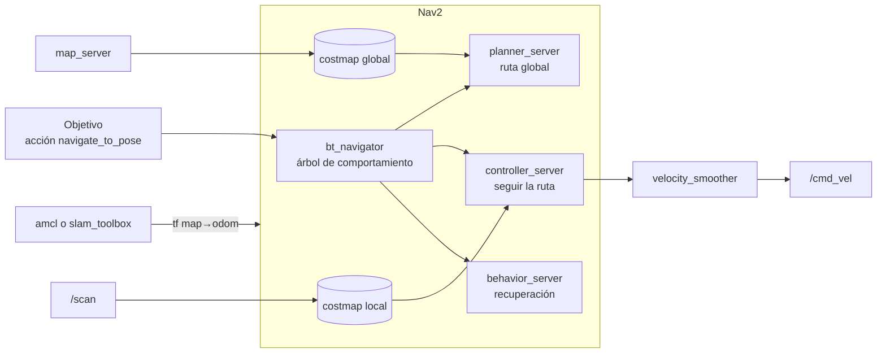

# Navegación con Nav2

<span class="bloque bloque-ros2">ROS 2 · Ubuntu 24.04 + Jazzy</span>

**Nav2** es el sistema de navegación de ROS 2, el sucesor de `move_base`. Al terminar este
tutorial entenderás sus piezas, habrás hecho un mapa con SLAM, habrás navegado con un robot
simulado y sabrás mandar objetivos desde Python.

!!! note "Requisitos"
    [ROS 2 Jazzy instalado](instalar-jazzy.md) y haber hecho la [introducción](introduccion.md).
    Todo el tutorial se hace en simulación con un **TurtleBot 3** en Gazebo.

## 1. Las piezas de Nav2

Las ideas son las mismas que en ROS 1 (mapa, localización, costmaps, planificador global y
local), pero Nav2 las reparte en más nodos y las coordina con un **árbol de comportamiento**
(*behavior tree*).



| Pieza de Nav2 | Qué hace | Equivalente en ROS 1 |
|---|---|---|
| `map_server` | Carga y publica el mapa | `map_server` |
| `amcl` | Localiza al robot en un mapa conocido | `amcl` |
| `slam_toolbox` | Hace el mapa mientras se localiza (SLAM) | `gmapping` |
| `planner_server` | Calcula la ruta global (NavFn, Smac...) | Planificador global de `move_base` |
| `controller_server` | Sigue la ruta evitando obstáculos (DWB, MPPI, Regulated Pure Pursuit...) | Planificador local de `move_base` |
| `behavior_server` | Acciones de recuperación: girar, retroceder, esperar | *Recovery behaviors* |
| `bt_navigator` | Coordina todo con un árbol de comportamiento | La lógica interna de `move_base` |
| `velocity_smoother` | Suaviza las velocidades antes de mandarlas a la base | — |
| `lifecycle_manager` | Arranca los nodos en orden y comprueba que están activos | — |
| Costmaps global y local | Mapas de coste por capas: estática, obstáculos, inflado | Igual |

!!! info "Nodos con ciclo de vida"
    Los nodos de Nav2 son *lifecycle nodes*: arrancan "inactivos" y el `lifecycle_manager` los
    activa en orden. Si algo falla al activarse, Nav2 no navega aunque los nodos existan. Lo
    verás en RViz como "Navigation: inactive".

Las **transformadas** necesarias son las mismas que en ROS 1:
`map → odom` (la publica `amcl` o `slam_toolbox`), `odom → base_link` (la odometría) y
`base_link → láser` (fija, del modelo del robot).

## 2. Instalar Nav2 y la simulación

```bash
sudo apt install -y ros-jazzy-navigation2 ros-jazzy-nav2-bringup \
                    ros-jazzy-slam-toolbox ros-jazzy-nav2-simple-commander \
                    ros-jazzy-teleop-twist-keyboard
```

`nav2_bringup` instala también los modelos simulados del TurtleBot 3 y 4 y el simulador
**Gazebo** (versión Harmonic). Si te faltaran:

```bash
sudo apt install -y ros-jazzy-nav2-minimal-tb* ros-jazzy-ros-gz
```

!!! tip "No hace falta `TURTLEBOT3_MODEL`"
    En tutoriales antiguos verás `export TURTLEBOT3_MODEL=burger` o `GAZEBO_MODEL_PATH`. Eso era
    para Gazebo Classic y versiones anteriores de ROS 2; con Jazzy no se usan.

## 3. Primera prueba: navegar con un mapa ya hecho

Nav2 trae una demo completa: Gazebo con un TurtleBot 3, un mapa del entorno, la localización,
Nav2 y RViz.

```bash
ros2 launch nav2_bringup tb3_simulation_launch.py headless:=False
```

`headless:=False` abre la ventana de Gazebo. Sin esa opción, la simulación corre igual pero
sin ventana (solo verías RViz).

En RViz:

1. Si abajo a la izquierda pone que Nav2 no está activo, pulsa **Startup**.
2. **Dile al robot dónde está:** pulsa **2D Pose Estimate**, haz clic donde está el robot en
   Gazebo y arrastra en la dirección en la que mira. Las partículas de AMCL se agruparán
   alrededor del robot y el láser coincidirá con el mapa.
3. **Mándalo a algún sitio:** pulsa **Nav2 Goal**, haz clic en el destino y arrastra para
   indicar la orientación final.

Verás la ruta global, el costmap y cómo el robot sigue la ruta.

!!! example "Experimenta"
    - En RViz, abajo a la izquierda, prueba el modo **Waypoint / Nav Through Poses**: marca
      varios puntos y pulsa **Start Waypoint Following**.
    - Añade un obstáculo en Gazebo en mitad de la ruta y observa cómo se replanifica.
    - Pon un objetivo dentro de una pared. ¿Qué hace?

## 4. Hacer tu propio mapa con SLAM

Cierra todo y lanza la misma demo, pero con SLAM en lugar de un mapa:

=== "Terminal 1: simulación + SLAM + Nav2"

    ```bash
    ros2 launch nav2_bringup tb3_simulation_launch.py headless:=False slam:=True
    ```

    Con `slam:=True` se usa `slam_toolbox` en vez de `map_server` + `amcl`: el mapa se
    construye a medida que el robot se mueve.

=== "Terminal 2: teleoperación"

    ```bash
    ros2 run teleop_twist_keyboard teleop_twist_keyboard
    ```

    Con esta terminal seleccionada, mueve el robot con ++i++ ++j++ ++l++ ++comma++ y frena con ++k++.

Recorre el entorno despacio. También puedes mandar objetivos con **Nav2 Goal** a zonas que ya
se vean en el mapa: Nav2 navega mientras se construye el mapa.

Cuando esté completo, guárdalo **sin cerrar nada**:

```bash
mkdir -p ~/mapas
ros2 run nav2_map_server map_saver_cli -f ~/mapas/mi_mapa
```

Se crean `mi_mapa.pgm` y `mi_mapa.yaml`, igual que en ROS 1.

Para navegar después con tu mapa:

```bash
ros2 launch nav2_bringup tb3_simulation_launch.py headless:=False \
    map:=$HOME/mapas/mi_mapa.yaml
```

## 5. Enviar objetivos desde Python

Nav2 incluye **`nav2_simple_commander`**, una librería que simplifica mucho mandar objetivos
desde Python: no hace falta escribir el cliente de la acción a mano.

Crea el archivo `ir_a_puntos.py` (en la carpeta `python/` de tu repo, por ejemplo):

```python
"""Manda al robot a una lista de puntos del mapa, uno detrás de otro."""
import math

import rclpy
from geometry_msgs.msg import PoseStamped
from nav2_simple_commander.robot_navigator import BasicNavigator, TaskResult

# (x, y, orientación en grados) en el sistema de coordenadas del mapa.
# Elige puntos libres de TU mapa (ver el consejo de abajo).
PUNTOS = [
    (-1.0, -0.5, 0),
    (0.5, 0.5, 90),
    (-2.0, -0.5, 180),
]


def crear_pose(navegador, x, y, yaw_grados):
    pose = PoseStamped()
    pose.header.frame_id = "map"
    pose.header.stamp = navegador.get_clock().now().to_msg()
    pose.pose.position.x = x
    pose.pose.position.y = y
    yaw = math.radians(yaw_grados)
    pose.pose.orientation.z = math.sin(yaw / 2)
    pose.pose.orientation.w = math.cos(yaw / 2)
    return pose


def main():
    rclpy.init()
    navegador = BasicNavigator()

    # Espera a que Nav2 esté activo (y a que tenga una pose inicial)
    navegador.waitUntilNav2Active()

    for x, y, yaw in PUNTOS:
        navegador.get_logger().info(f"Yendo a ({x}, {y}, {yaw}°)")
        navegador.goToPose(crear_pose(navegador, x, y, yaw))

        while not navegador.isTaskComplete():
            feedback = navegador.getFeedback()
            if feedback:
                restante = feedback.distance_remaining
                print(f"  Distancia restante: {restante:.2f} m", end="\r")

        resultado = navegador.getResult()
        if resultado == TaskResult.SUCCEEDED:
            navegador.get_logger().info("¡Llegado!")
        elif resultado == TaskResult.CANCELED:
            navegador.get_logger().warn("Objetivo cancelado")
        else:
            navegador.get_logger().warn("No se pudo llegar")

    rclpy.shutdown()


if __name__ == "__main__":
    main()
```

Con la demo del apartado 3 en marcha y la pose inicial ya puesta en RViz:

```bash
python3 ir_a_puntos.py
```

!!! tip "¿Cómo sé las coordenadas de un punto del mapa?"
    En RViz, usa la herramienta **Publish Point** y haz clic en el mapa. En otra terminal verás
    las coordenadas con `ros2 topic echo /clicked_point`.

`BasicNavigator` tiene más funciones útiles: `setInitialPose()` para fijar la pose inicial
desde código, `goThroughPoses()` para pasar por varios puntos sin pararse, `followWaypoints()`
y `cancelTask()`.

## 6. Los parámetros

Toda la configuración de Nav2 está en un único archivo YAML. El de la demo está en:

```bash
ls $(ros2 pkg prefix nav2_bringup)/share/nav2_bringup/params/
```

El archivo `nav2_params.yaml` tiene una sección por nodo (`amcl`, `controller_server`,
`planner_server`, `local_costmap`, `global_costmap`...).

| Parámetro | Dónde | Efecto |
|---|---|---|
| `robot_radius` o `footprint` | `local_costmap`, `global_costmap` | Tamaño del robot |
| `inflation_radius` | Capa `inflation_layer` de los costmaps | Margen de seguridad alrededor de los obstáculos |
| `cost_scaling_factor` | Capa `inflation_layer` | Qué tan rápido baja el coste al alejarse de un obstáculo |
| `xy_goal_tolerance`, `yaw_goal_tolerance` | `controller_server` → `general_goal_checker` | Cuánto se puede desviar del objetivo para darlo por alcanzado |
| Velocidades máximas | `controller_server` → `FollowPath` | Depende del controlador: `max_vel_x` en DWB, `vx_max` en MPPI... |
| `plugin` de `GridBased` | `planner_server` | Qué planificador global se usa |
| `plugin` de `FollowPath` | `controller_server` | Qué controlador local se usa |

Para saber qué controlador usa la demo:

```bash
grep -A2 "FollowPath:" $(ros2 pkg prefix nav2_bringup)/share/nav2_bringup/params/nav2_params.yaml
```

Para usar tus propios parámetros, **copia el archivo a tu paquete** (no edites el de
`/opt/ros`) y pásalo al lanzar:

```bash
ros2 launch nav2_bringup tb3_simulation_launch.py headless:=False \
    params_file:=/ruta/a/mis_params.yaml
```

**Ajustar en vivo:** con Nav2 en marcha puedes cambiar muchos parámetros sin relanzar:

```bash
ros2 param set /controller_server general_goal_checker.xy_goal_tolerance 0.1
```

o con la interfaz gráfica: `ros2 run rqt_reconfigure rqt_reconfigure`.

## 7. Planificadores y controladores disponibles

| Tipo | Plugin | Notas |
|---|---|---|
| Global | `nav2_navfn_planner::NavfnPlanner` | Dijkstra o A\*. Sencillo y robusto |
| Global | `nav2_smac_planner::SmacPlanner2D` | A\* en rejilla 2D |
| Global | `nav2_smac_planner::SmacPlannerHybrid` | Hybrid-A\*: tiene en cuenta el radio de giro (robots tipo coche) |
| Global | `nav2_theta_star_planner::ThetaStarPlanner` | Rutas con menos giros |
| Local | `dwb_core::DWBLocalPlanner` | Evolución del DWA de ROS 1 |
| Local | `nav2_mppi_controller::MPPIController` | Control predictivo por muestreo; trayectorias muy suaves |
| Local | `nav2_regulated_pure_pursuit_controller::RegulatedPurePursuitController` | Sigue la ruta con *pure pursuit*; simple y fiable |

Si tu TFG es de **path planning**, lo normal es escribir tu propio planificador como plugin
(una clase que hereda de `nav2_core::GlobalPlanner`). Nav2 tiene un tutorial oficial:
[Writing a New Planner Plugin](https://docs.nav2.org/plugin_tutorials/docs/writing_new_nav2planner_plugin.html).
Prototipa antes el algoritmo en Python puro, en la carpeta `python/` de tu repo.

## 8. Herramientas de depuración

| Herramienta | Para qué |
|---|---|
| `ros2 run tf2_tools view_frames` | Genera un PDF con el árbol de transformadas |
| `ros2 run tf2_ros tf2_echo map base_link` | Posición del robot en el mapa |
| `ros2 lifecycle get /planner_server` | Estado de un nodo de Nav2 (debe ser `active`) |
| `ros2 topic echo /plan --once` | La ruta global calculada |
| `ros2 topic hz /scan` | Comprobar que el láser publica |
| `rqt_graph` | Nodos y topics conectados |

## Problemas frecuentes

??? failure "RViz dice que Nav2 está inactivo y los objetivos no hacen nada"
    Pulsa **Startup** en el panel de Nav2 de RViz. Si sigue inactivo, mira la terminal: algún
    nodo no ha podido activarse (casi siempre por falta de mapa, de transformadas o de pose
    inicial).

??? failure "El robot no se mueve al dar un objetivo"
    ¿Has puesto la pose inicial con **2D Pose Estimate**? Sin ella, AMCL no publica
    `map → odom` y Nav2 no sabe dónde está el robot.

??? failure "`Failed to create plan` / el planificador no encuentra ruta"
    El objetivo o el robot están dentro de una zona ocupada o inflada del costmap. Prueba otro
    punto o reduce `inflation_radius`.

??? failure "Gazebo va muy lento o la ventana sale negra"
    Gazebo necesita aceleración gráfica: usa una instalación nativa de Ubuntu con los drivers de
    la tarjeta gráfica instalados. Puedes lanzar sin ventana de Gazebo (sin `headless:=False`)
    y trabajar solo con RViz.

??? failure "Al cerrar la demo salen muchos errores"
    Es normal al pulsar ++ctrl+c++ en la demo de Nav2. Si al volver a lanzarla algo va mal,
    asegúrate de que no ha quedado ningún proceso de Gazebo abierto:
    `pkill -f "gz sim"`.

## Para seguir aprendiendo

- [Documentación de Nav2](https://docs.nav2.org/): conceptos, tutoriales y configuración de
  cada plugin.
- [Guía de ajuste de Nav2](https://docs.nav2.org/tuning/index.html): cómo elegir y ajustar
  planificadores y controladores.
- Siguiente tutorial del grupo: [Cámara RealSense :octicons-arrow-right-24:](realsense.md)
