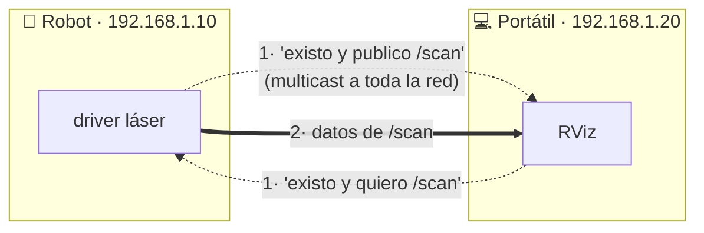

# ROS 2 en varios ordenadores

<span class="bloque bloque-ros2">ROS 2 · Ubuntu 24.04 + Jazzy</span>

Al terminar este tutorial sabrás conectar dos ordenadores con ROS 2 (por ejemplo, tu portátil
y el ordenador de un robot), evitar interferencias con otros equipos del laboratorio y
resolver los problemas de red más habituales.

!!! note "Requisitos"
    [ROS 2 Jazzy instalado](instalar-jazzy.md) en los dos ordenadores y haber hecho la
    [introducción](introduccion.md).

## 1. Cómo se encuentran los nodos en ROS 2

En ROS 2 **no hay master**. Cada nodo anuncia por la red que existe y qué publica, y los
demás nodos lo escuchan. Este sistema de descubrimiento lo hace **DDS**, la capa de
comunicación sobre la que funciona ROS 2.



Consecuencias prácticas:

- **No hay que configurar direcciones IP** en el caso normal: si los dos ordenadores están en
  la misma red y esa red deja pasar el descubrimiento, se ven solos.
- **Todos los ordenadores de la red se ven entre sí.** Si cinco personas trabajan con ROS 2
  en el laboratorio, sin más configuración, todos verán los topics de todos (y RViz de uno
  podría mover el robot de otro). Por eso existe `ROS_DOMAIN_ID`.

| ROS 1 | ROS 2 |
|---|---|
| `roscore` en un ordenador | Nada: no hay master |
| `ROS_MASTER_URI` y `ROS_IP` | `ROS_DOMAIN_ID` (y, si hace falta, `ROS_STATIC_PEERS`) |
| Si el master cae, todo se para | Cada nodo funciona por su cuenta |

## 2. Las variables de entorno

| Variable | Qué hace | Valor |
|---|---|---|
| `ROS_DOMAIN_ID` | Separa la red en "grupos". Solo se ven los nodos con **el mismo número** | Un número entre 0 y 101. Por defecto, 0 |
| `ROS_AUTOMATIC_DISCOVERY_RANGE` | Hasta dónde busca otros nodos | `SUBNET` (por defecto, toda tu red), `LOCALHOST` (solo tu ordenador), `OFF` |
| `ROS_STATIC_PEERS` | IPs de otros ordenadores a los que conectarse directamente, aunque la red bloquee el descubrimiento automático | `192.168.1.10;192.168.1.11` |
| `RMW_IMPLEMENTATION` | Qué implementación de DDS se usa. **Tiene que ser la misma en todos los ordenadores** | Por defecto `rmw_fastrtps_cpp`. No la cambies salvo que te lo digan |

!!! warning "Usa un `ROS_DOMAIN_ID` propio"
    En el laboratorio, cada robot (o cada persona, si trabaja en simulación) debe usar un
    número distinto. **Pregunta a tu tutor/a qué número te toca** y ponlo en tu `~/.bashrc`:

    ```bash
    echo "export ROS_DOMAIN_ID=NUMERO" >> ~/.bashrc
    ```

    Si trabajas solo en tu ordenador, también puedes limitarte a él con
    `export ROS_AUTOMATIC_DISCOVERY_RANGE=LOCALHOST`.

Como en ROS 1, estas variables valen **solo para la terminal donde las defines**. Para ver
qué tiene una terminal:

```bash
env | grep -E "ROS|RMW"
```

## 3. Paso a paso: conectar dos ordenadores

### 3.1. Misma red

Conecta los dos ordenadores a **la misma red del laboratorio** (el router del grupo).

!!! warning "La wifi de la universidad no sirve"
    Las redes institucionales (eduroam y similares) **bloquean por seguridad** las conexiones
    directas entre dispositivos y el tráfico de descubrimiento de ROS 2. Aunque los dos
    tengan internet, no se verán. Usa siempre el router del laboratorio.

Mira la IP de cada uno con `hostname -I` y comprueba que se ven **en los dos sentidos**:

```bash
ping IP_DEL_OTRO_ORDENADOR
```

### 3.2. Mismo dominio en los dos

En **todas** las terminales de **los dos** ordenadores:

```bash
export ROS_DOMAIN_ID=NUMERO       # el mismo número en ambos
```

### 3.3. La prueba

=== "Ordenador A"

    ```bash
    ros2 run demo_nodes_cpp talker
    ```

=== "Ordenador B"

    ```bash
    ros2 run demo_nodes_py listener
    ```

Si el ordenador B recibe los mensajes, la red funciona. **Haz también la prueba al revés**
(talker en B, listener en A).

### 3.4. Si no se ven: comprobar el multicast

El descubrimiento automático usa *multicast*, que algunos routers o redes bloquean. ROS 2
trae una prueba:

=== "Ordenador A"

    ```bash
    ros2 multicast receive
    ```

=== "Ordenador B"

    ```bash
    ros2 multicast send
    ```

Si A no recibe el mensaje, la red bloquea el multicast. La solución es decirle a cada
ordenador la IP del otro con `ROS_STATIC_PEERS`:

```bash
# En el ordenador A (192.168.1.20)
export ROS_STATIC_PEERS=192.168.1.10

# En el ordenador B (192.168.1.10)
export ROS_STATIC_PEERS=192.168.1.20
```

## 4. Dejarlo configurado en el `.bashrc`

Igual que en ROS 1, es cómodo tener dos modos:

```bash
# --- Red ROS 2 ---------------------------------------------------------
export ROS_DOMAIN_ID=NUMERO          # el que te haya asignado tu tutor/a

# Solo mi ordenador (simulación, pruebas)
ros2_local() {
    export ROS_AUTOMATIC_DISCOVERY_RANGE=LOCALHOST
    unset ROS_STATIC_PEERS
    ros2 daemon stop > /dev/null 2>&1
    echo "ROS 2 en modo LOCAL (dominio ${ROS_DOMAIN_ID})"
}

# Con otros ordenadores de la red
ros2_red() {
    export ROS_AUTOMATIC_DISCOVERY_RANGE=SUBNET
    ros2 daemon stop > /dev/null 2>&1
    echo "ROS 2 en modo RED (dominio ${ROS_DOMAIN_ID})"
}

ros2_local   # modo por defecto al abrir una terminal
```

!!! info "¿Qué es el `ros2 daemon`?"
    Es un proceso en segundo plano que guarda una lista de los nodos y topics que ha visto,
    para que `ros2 topic list` responda rápido. Al cambiar la configuración de red se queda
    con la lista vieja, por eso las funciones lo reinician con `ros2 daemon stop` (vuelve a
    arrancar solo).

## 5. Entrar en otro ordenador: SSH y `tmux`

Funciona exactamente igual que en ROS 1: mira el apartado de
[SSH y tmux del tutorial de ROS 1](../ros1/red.md#6-entrar-en-el-robot-por-ssh).

## 6. Relojes sincronizados

También igual que en ROS 1: si los relojes de los dos ordenadores no coinciden, aparecen
errores de transformadas (`extrapolation into the future`). Instala `chrony` en los dos:

```bash
sudo apt install -y chrony
```

## 7. Datos pesados por wifi

Las imágenes y nubes de puntos sin comprimir saturan la wifi. Algunas ideas:

- Visualiza las imágenes comprimidas: instala `ros-jazzy-image-transport-plugins` en los dos
  ordenadores y suscríbete al topic `.../image_raw/compressed`.
- Baja la resolución y los FPS de la cámara en el robot.
- Procesa los datos **en el robot** y manda por la red solo el resultado.

## 8. ¿Y los robots del grupo, que usan ROS 1?

ROS 1 y ROS 2 **no se comunican directamente**: un nodo de ROS 2 no ve los topics de un
`roscore` de ROS 1. Para unirlos existe un puente (`ros1_bridge`), pero necesita tener los dos
ROS en el mismo ordenador y no es trivial de montar. Si tu trabajo necesita usar un robot del
grupo desde ROS 2, coméntalo con tu tutor/a antes de empezar.

## Problemas frecuentes

??? failure "`ros2 topic list` no muestra los topics del otro ordenador"
    1. ¿Mismo `ROS_DOMAIN_ID` en los dos? (`echo $ROS_DOMAIN_ID`)
    2. ¿`ROS_AUTOMATIC_DISCOVERY_RANGE` en `LOCALHOST` en alguno? Ponlo en `SUBNET`.
    3. Reinicia el daemon: `ros2 daemon stop`.
    4. ¿Funciona `ping` en los dos sentidos?
    5. Haz la prueba de multicast del [apartado 3.4](#34-si-no-se-ven-comprobar-el-multicast).

??? failure "Veo los topics de otra persona del laboratorio"
    Estáis usando el mismo `ROS_DOMAIN_ID`. Cambia al número que te corresponda.

??? failure "Los topics aparecen pero no llegan datos"
    Suele ser el cortafuegos de alguno de los ordenadores. Mira su estado con
    `sudo ufw status` y, si está activo, permite el tráfico de la red del laboratorio:
    ```bash
    sudo ufw allow from 192.168.1.0/24
    ```
    (cambia la red por la vuestra). También puede ser que uno use un `RMW_IMPLEMENTATION`
    distinto: compruébalo con `env | grep RMW` en los dos.

??? failure "Los topics siguen apareciendo después de cerrar los nodos"
    Es la lista antigua del daemon. `ros2 daemon stop` y vuelve a probar.

## Chuleta

```bash
hostname -I                                  # mi IP
ping IP_DEL_OTRO                             # ¿nos vemos?
env | grep -E "ROS|RMW"                      # ¿qué tengo configurado?
export ROS_DOMAIN_ID=NUMERO                  # mismo número en todos los ordenadores
export ROS_AUTOMATIC_DISCOVERY_RANGE=SUBNET  # buscar en toda la red (LOCALHOST: solo yo)
export ROS_STATIC_PEERS="IP1;IP2"            # si la red bloquea el multicast
ros2 daemon stop                             # olvidar la lista antigua de nodos
ros2 multicast receive / send                # probar el multicast
```
